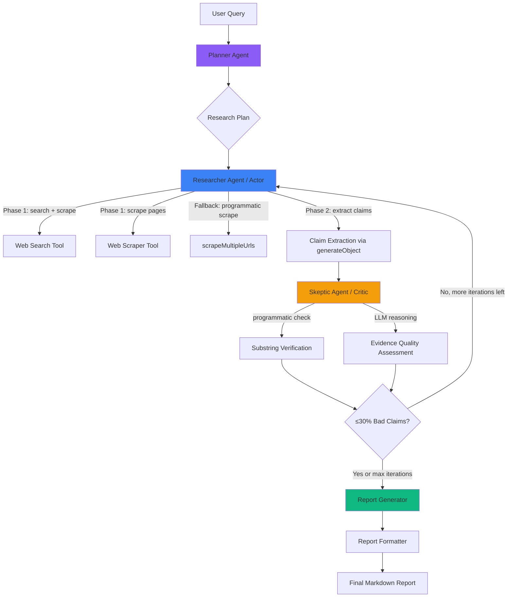

# Argus — Actor-Critic AI Research Agent

## 1. Problem Framing & Assumptions

LLMs hallucinate. When you ask one to research a topic, it will confidently fabricate quotes, invent citations, and pass off guesses as facts. For a research agent, this is the central problem — not speed, not coverage, but *truthfulness*.

Argus tackles this with an Actor-Critic loop. The Researcher (Actor) searches the web and extracts claims with verbatim evidence. The Skeptic (Critic) verifies each claim by performing a programmatic substring match of the quoted text against the raw scraped source. If the quote isn't there, the claim is refuted — no LLM reasoning can override that. This turns "silent hallucination" into "caught and flagged."

**Assumptions:**

- **LLM:** Grok-4.1-fast (`x-ai/grok-4.1-fast`) via OpenRouter, accessed through the Vercel AI SDK v6 and `@openrouter/ai-sdk-provider`. Chosen for strong tool-calling and structured output.
- **Tools:** Tavily for web search, Jina Reader for scraping.
- **Scope:** Single-session, no persistence. Each query is a fresh investigation, completing in 1–5 minutes.
- **Philosophy:** Correctness over breadth. Fewer verified claims beat many unverified ones.

## Demo

[Argus Walkthrough.mp4](Argus%20Walkthrough.mp4)

## 2. Architecture

Four agents — Planner, Researcher, Skeptic, Report Generator — coordinated by an orchestrator (`lib/agents/orchestrator.ts`) that runs the Actor-Critic loop. A fifth component, the Report Formatter, is a pure function (no LLM) that converts the report to Markdown.

Everything flows through `ResearchState` (`lib/schemas/research-state.ts`), a single mutable state object. The key design choice: `rawScrapedContent` is a `Record<string, string>` mapping URLs to their full scraped text. This shared "evidence vault" means the Skeptic verifies against the exact text the Researcher saw — it can't re-fetch or hallucinate source content.




On the frontend side, the orchestrator is an `AsyncGenerator` that yields typed `StreamEvent` objects (a discriminated union with 9 event types defined in `lib/schemas/stream-events.ts`). The API route (`app/api/research/route.ts`) streams these as SSE; the React frontend consumes them via `useResearch` (`lib/hooks/use-research.ts`).

## 3. Agent Loop Design

### State

`ResearchState` (`lib/schemas/research-state.ts`) accumulates everything across iterations: `phase` (idle → planning → researching → critiquing → synthesizing → complete), `plan`, `claims`, `sources`, `rawScrapedContent`, `researcherNotes`, `skepticFeedback`, and a `trace` for observability. The `researcherNotes` and `skepticFeedback` fields are how agents communicate across iterations — the Skeptic says "these claims had problems, look for X," and the Researcher reads that in the next round.

### Agents

**Planner** (`lib/agents/planner.ts`) — Decomposes the query into 2–6 research angles via `generateObject`. Each angle has a search strategy and priority. Also refines the raw query into a clearer research question.

**Researcher** (`lib/agents/researcher.ts`) — Two-phase design. Phase 1: `generateText` with `stopWhen: stepCountIs(20)` for agentic tool calling (search + scrape). If the model doesn't scrape enough pages (they often don't), a programmatic fallback calls `scrapeMultipleUrls()` to fill the gap. Phase 2: `generateObject` extracts 5–15 structured claims with verbatim quotes from the scraped content. The two-phase split is intentional — mixing search and extraction in one call produces worse evidence because the model tries to do too much at once.

**Skeptic** (`lib/agents/skeptic.ts`) — Two-layer verification. First, `verifyQuotesAgainstRawContent()` does a deterministic case-insensitive substring match. Results are injected as system notes into the LLM prompt. The LLM then produces verdicts via `generateObject`. The critical override: if all supporting quotes fail the substring check, the claim is forced to `refuted` regardless of what the LLM thinks. The Skeptic has **no tools** — it can't search or scrape, only evaluate what it's given.

**Report Generator** (`lib/agents/report-generator.ts`) — Uses `generateObject` with `FinalReportSchema.omit(...)`. The LLM writes narrative; computed fields (claim counts, source list, trace step count) are filled programmatically. The **Report Formatter** (`lib/agents/report-formatter.ts`) converts this to Markdown with an Evidence Scorecard table.

### Prompts

Two prompt decisions matter most. The Researcher's claim extraction prompt warns: *"a verification system will check this by doing a substring match"* — telling the model its quotes will be checked dramatically reduces fabrication. The Skeptic's system prompt requires BOTH quote presence AND logical support for verification — a real quote that doesn't actually support the claim gets `insufficient_evidence`, not `verified`. Zod `.describe()` annotations double as implicit prompt engineering.

### Tools

- **webSearch** (`lib/tools/web-search.ts`): Wraps Tavily. 1–5 parallel queries, URL dedup, source classification via `classifySourceType()` (pattern-matching URLs against academic, gov, news, industry indicators).
- **webScraper** (`lib/tools/web-scraper.ts`): Wraps Jina Reader (`https://r.jina.ai/{url}`). 30s timeout, 50K char truncation, rejects pages under 100 chars. Exports `scrapeMultipleUrls()` for the fallback path (up to 5 URLs via `Promise.allSettled`).

### Loop Logic

The orchestrator loops Researcher→Skeptic up to `maxIterations` (default 3). Exit condition: if >30% of claims are `refuted` or `insufficient_evidence` and iterations remain, keep going. Otherwise, proceed to synthesis. This means the system re-investigates when quality is poor and stops early when it's good enough.

## 4. Data & Trace Model

All schemas are composable Zod objects in `lib/schemas/`:


| Schema          | File               | Key Fields                                                                                                                                                                                                        |
| --------------- | ------------------ | ----------------------------------------------------------------------------------------------------------------------------------------------------------------------------------------------------------------- |
| `SourceURL`     | `source.ts`        | `url`, `title`, `domain`, `sourceType`, `scrapedAt`, `rawContentLength`                                                                                                                                           |
| `EvidenceQuote` | `evidence.ts`      | `verbatimQuote` (min 10 chars), `sourceUrl`, `sourceTitle`, `relevanceReasoning`                                                                                                                                  |
| `Claim`         | `claim.ts`         | `id`, `statement`, `category`, `claimType` (factual/statistical/causal/comparative/evaluative), `supportingEvidence: EvidenceQuote[]`, `status` (unverified/verified/refuted/insufficient_evidence), `confidence` |
| `ResearchPlan`  | `research-plan.ts` | `originalQuery`, `refinedQuestion`, `angles[]` (2–6, each with search strategy + priority)                                                                                                                        |
| `FinalReport`   | `report.ts`        | `title`, `summary`, `sections[]`, `verifiedClaimCount`, `refutedClaimCount`, `sources: SourceURL[]`                                                                                                               |


Schemas compose naturally (`Claim` contains `EvidenceQuote[]`, `FinalReport` contains `SourceURL[]`), and `.describe()` annotations flow into LLM structured output as field-level instructions.

**Trace model** (`lib/schemas/trace.ts`): `TraceStep` captures each agent invocation (`id`, `timestamp`, `agent`, `action`, `durationMs`, optional `metadata`). `TraceRecord` aggregates all steps for a session with a `metricsSnapshot` captured at completion. Full lineage from query → plan → searches → claims → verdicts → report.

**Stream events** (`lib/schemas/stream-events.ts`): Discriminated union with 9 types (`plan-created`, `phase-change`, `claim-added`, `claim-updated`, `source-added`, `researcher-update`, `skeptic-update`, `report-complete`, `error`) enabling real-time UI updates via SSE.

## 5. Reliability & Safety

- **Retry with backoff** (`lib/retry.ts`): Exponential backoff with jitter (base 1s, max 10s, 3 retries). Checks `ResearchError.retryable` before retrying. Used by Researcher, Skeptic, and web search. Tavily calls use `retryIf: () => true` to retry all errors.
- **Programmatic verification override**: The core safety mechanism. `verifyQuotesAgainstRawContent()` is deterministic — if the quote isn't a substring of the raw text, no LLM reasoning changes the outcome. This catches fabricated evidence by construction.
- **Timeouts & bounds**: 30s scrape timeout, 50K char truncation, 100 char minimum content length, `stepCountIs(20)` cap on tool-calling rounds.
- **Error isolation**: `Promise.allSettled` everywhere — individual search queries and scrape requests can fail without killing the session. Custom `ResearchError` classes (`lib/errors.ts`) carry `retryable` flags and typed codes (`SEARCH_FAILED`, `SCRAPE_FAILED`, `LLM_FAILED`, `VALIDATION_FAILED`, `PLANNING_FAILED`).
- **Input validation**: Zod at every boundary — API request body (`query` max 1000 chars, `maxIterations` 1–5), LLM structured output, and env vars (`lib/env.ts` with `zod-validation-error`).
- **No arbitrary code execution**: The agent only reads web content as text via Jina Reader. No JS execution, no filesystem access, no shell.

## 6. Observability & Metrics

`withTelemetry` (`lib/telemetry.ts`) wraps every operation with span timing and key-value attributes. Format: `[SPAN] ✓ web-search duration=1234ms queryCount=3`. `logEvent` captures discrete events (`research_started`, `programmatic_scrape`, `retry_attempt`, etc.).

The `MetricsCollector` singleton tracks counters (`llm_calls`, `searches_executed`, `claims_generated`, `claims_verified`, `claims_refuted`, `iterations_completed`) and span summaries (count, avg duration, error rate per operation). These get embedded in `TraceRecord.metricsSnapshot` at session completion.

**In production I'd add:** OpenTelemetry SDK, Jaeger for tracing, Prometheus + Grafana for metrics and alerting, token usage tracking, cost attribution per session.

## 7. Tradeoffs


| Decision                          | What we chose                                              | What we gave up                                    | Why                                                                   |
| --------------------------------- | ---------------------------------------------------------- | -------------------------------------------------- | --------------------------------------------------------------------- |
| Two-phase Researcher              | Extra LLM call per iteration for separate claim extraction | Lower cost (single call)                           | Mixing search + extraction in one call produces worse evidence        |
| Verbatim quote requirement        | Deterministic verification via substring match             | Claims supported by paraphrased evidence           | Precision over recall — fabricated evidence is caught, not guessed at |
| Single-process Next.js            | Simple deployment, no infra overhead                       | Horizontal scaling, session persistence            | Right for a PoC; Section 8 covers the production path                 |
| Jina Reader over headless browser | Fast, free, no infrastructure                              | JS-rendered SPA content                            | Academic papers, blogs, and news articles are all server-rendered     |
| URL-pattern source classification | Simple, no external API calls                              | Accuracy (a `.io` could be academic or commercial) | Good enough for prioritization; production would use metadata APIs    |
| >30% bad claims threshold         | Balances re-investigation vs. diminishing returns          | Thoroughness on edge cases                         | If 9/10 claims pass, two more iterations won't help                   |


## 8. Future Extension — Unlimited Time Design

If I had unlimited time and a team, Argus would evolve from a single-process Node.js app into a distributed platform. Here's what I'd build and why.

**Go backend.** The orchestrator moves to Go. Goroutines are a natural fit for parallel agent execution — each research angle investigated concurrently, results coordinated via channels. The memory footprint matters: goroutines start at ~2KB vs. the closure-heavy context of Node.js Promise chains, so a single server handles dozens of concurrent sessions. The LLM client becomes a thin wrapper around OpenRouter's REST API since the Vercel AI SDK's value (streaming helpers, React hooks) is frontend-specific.

**Temporal.io for workflow orchestration.** Each research session becomes a Temporal Workflow; each agent invocation is a Temporal Activity. This solves the problems the current in-memory orchestrator can't: durable execution (server crash mid-research → Temporal replays from the last checkpoint), automatic retries with proper heartbeats and backoff policies (replacing our custom `withRetry`), workflow history that subsumes our `TraceRecord`, and workflow versioning so deploying new agent logic doesn't break in-flight sessions. The Actor-Critic loop maps directly to a Temporal loop construct.

**Kafka as the event bus.** All `StreamEvent` objects go to a Kafka topic partitioned by session ID. Frontend subscribes via a WebSocket-to-Kafka bridge. The wins over SSE: event replay (reconnecting users pick up where they left off), decoupling (monitoring, audit logging, and metrics aggregation all consume independently), horizontal scaling (multiple orchestrator instances produce to the same topic), and event sourcing for a full audit trail of every research session.

**Skeptic quorum via multi-model consensus.** The single-Skeptic design has a weakness: if the LLM has a systematic blind spot, it propagates unchecked. The fix is running N Skeptic instances across different models (Grok, Claude, GPT-4) and requiring majority agreement for verification — essentially an ensemble approach. Coordination via etcd for leader election and verdict tallying. Cost scales linearly with N, but correlated failures across model families are rare, so reliability improves substantially.

**PostgreSQL + pgvector for persistence.** Research states, claims, and evidence stored in Postgres. Vector embeddings on claims enable semantic deduplication across sessions — overlapping research topics surface previously verified claims instead of re-investigating. Row-level security for multi-tenancy, audit logging via triggers, full-text search on claim text.

**Redis for caching and rate limiting.** Scraped content cached with 24h TTL (LRU eviction) to avoid redundant Jina calls for popular URLs. Rate limiting via sliding-window counters per user and per upstream API to prevent cost overruns.

**gRPC between services.** As the system decomposes (orchestrator, Skeptic cluster, scraper pool, storage), inter-service communication uses gRPC with protobuf schemas for schema evolution, compact serialization, and cross-language code generation. Envoy sidecar for mTLS, circuit breaking, and load balancing.

**How it scales.** Research sessions scale horizontally via Temporal task queues. Kafka partitioning ensures per-session ordering across parallel orchestrator instances. The Skeptic cluster and scraper pool scale independently based on queue depth. This architecture handles hundreds of concurrent sessions while keeping the correctness guarantees from the current single-process design.

## 9. Working Agent & Test Cases

### Implementation

Two real tools: **web search** (Tavily) and **web scraper** (Jina Reader). Four LLM agents (Planner, Researcher, Skeptic, Report Generator) using the Vercel AI SDK v6's `generateObject` and `generateText`. LLM: Grok-4.1-fast via OpenRouter, configured in `lib/ai/model.ts`.

### Test Run

- **Query:** *"What are the real-world risks and benefits of using synthetic data to train or fine-tune large language models? Focus on data quality, bias, and evaluation."*
- **Plan:** 5 angles — data quality benefits, model collapse risks, bias amplification, evaluation challenges, real-world case studies.
- **Result:** 11 claims extracted, 10 verified, **1 refuted**. Loop exited after 1 iteration (~9% bad claims ≤ 30% threshold). 150+ sources discovered across academic (arXiv, Nature, ACL Anthology), industry (Rubrik, neptune.ai, Google Research), news (TechCrunch, Reuters), and government (NIH/PMC) sources.
- **Final report:** Sections for Benefits, Model Collapse Risks, Evaluation Challenges, Real-World Case Studies, and Limitations & Refuted Claims. Evidence Scorecard: 10 verified, 1 refuted, 0 insufficient evidence.

> **Sample Verification — Verified Claim**
>
> **Claim:** *"Indiscriminately learning from data produced by other models causes model collapse in LLMs."*
>
> **Quote:** `"indiscriminately learning from data produced by other models causes 'model collapse'—a degenerative process"`
>
> **Source:** Nature — *"AI models collapse when trained on recursively generated data"*
>
> **Programmatic check:** `rawScrapedContent[url].toLowerCase().includes(quote.toLowerCase())` → **`true`**. Verdict: **verified**, confidence 1.0.

> **Sample Verification — Refuted Claim (real example from this run)**
>
> **Claim:** *"Bias amplification persists independently of model collapse in LLMs trained iteratively on synthetic data."*
>
> **Quote:** `"bias amplification persists independently of model collapse, even when the latter is effectively controlled"`
>
> **Source:** holisticai.com — *"Bias Amplification: Large Language Models as Increasingly Biased Media"*
>
> **Programmatic check:** `rawScrapedContent[url].toLowerCase().includes(quote.toLowerCase())` → **`false`** — quote not found in raw scraped text. The source discussed the topic but the Researcher paraphrased rather than copying verbatim. The override in `lib/agents/skeptic.ts` forced the claim to **refuted** regardless of the LLM's reasoning. This is the system working exactly as designed — catching fabricated evidence deterministically.

### How to Run

```bash
git clone <repo-url> && cd argus
fnm use             # Node 24+ (project includes .node-version)
pnpm install
cp .env.example .env.local   # Fill in API keys
pnpm dev
# Open http://localhost:3000 and enter the test prompt
```

### Environment Variables


| Variable             | Description                                                    | Required |
| -------------------- | -------------------------------------------------------------- | -------- |
| `OPENROUTER_API_KEY` | [OpenRouter](https://openrouter.ai/) API key for Grok-4.1-fast | Yes      |
| `TAVILY_API_KEY`     | [Tavily](https://tavily.com/) API key for web search           | Yes      |


### Tech Stack


| Component     | Version                                             |
| ------------- | --------------------------------------------------- |
| Next.js       | 16.1.6                                              |
| React         | 19.2.3                                              |
| Vercel AI SDK | `ai@^6.0.97`                                        |
| Zod           | `zod@^4.3.6`                                        |
| TypeScript    | 5                                                   |
| Tailwind CSS  | 4                                                   |
| LLM           | Grok-4.1-fast (`x-ai/grok-4.1-fast`) via OpenRouter |
| Search        | Tavily (`@tavily/core@^0.7.1`)                      |
| Scraping      | Jina Reader                                         |


