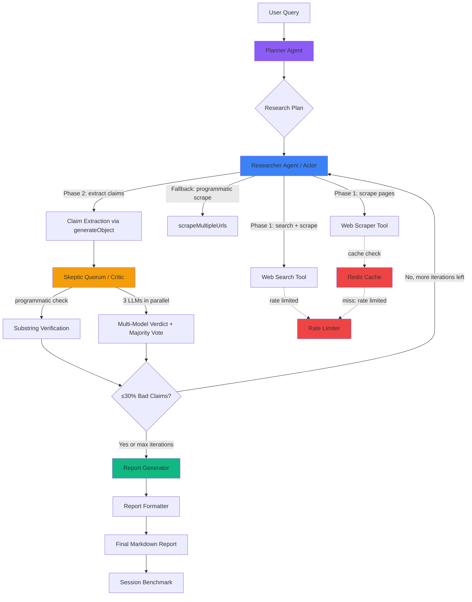

# Argus — Actor-Critic AI Research Agent

## 1. Problem Framing & Assumptions

LLMs hallucinate. When you ask one to research a topic, it will confidently fabricate quotes, invent citations, and pass off guesses as facts. For a research agent, this is the central problem — not speed, not coverage, but *truthfulness*.

Argus tackles this with an Actor-Critic loop backed by multi-model ensemble verification. The Researcher (Actor) searches the web and extracts claims with verbatim evidence. The Skeptic Quorum (Critic) runs three independent LLM models in parallel, each verifying claims against raw scraped sources via programmatic substring matching. Majority voting determines the final verdict — if the quote isn't there, the claim is refuted regardless of what any LLM thinks. This turns "silent hallucination" into "caught and flagged."

**Assumptions:**

- **LLMs:** Grok-4.1-fast for planning, research, and report generation. Skeptic quorum uses three models via OpenRouter: Grok-4.1-fast, Gemini 3 Flash Preview, and Gemini 2.5 Flash — all accessed through the Vercel AI SDK v6.
- **Tools:** Tavily for web search, Jina Reader for scraping, Redis for caching and rate limiting.
- **Scope:** Single-session with benchmark persistence. Each query is a fresh investigation, completing in 1–5 minutes. Session benchmarks are saved to disk for tracking improvements over time.
- **Philosophy:** Correctness over breadth. Fewer verified claims beat many unverified ones.

## Demo

https://github.com/user-attachments/assets/1ac0aa69-45c2-4488-86ed-96d8bc0648ca

## 2. Architecture

Four agents — Planner, Researcher, Skeptic Quorum, Report Generator — coordinated by an orchestrator (`lib/agents/orchestrator.ts`) that runs the Actor-Critic loop. The Skeptic runs as a quorum of three LLM models with majority voting. A caching layer (Redis) sits in front of the web scraper to avoid redundant fetches, and a sliding-window rate limiter protects upstream APIs.

Everything flows through `ResearchState` (`lib/schemas/research-state.ts`), a single mutable state object. The key design choice: `rawScrapedContent` is a `Record<string, string>` mapping URLs to their full scraped text. This shared "evidence vault" means the Skeptic verifies against the exact text the Researcher saw — it can't re-fetch or hallucinate source content.



On the frontend side, the orchestrator is an `AsyncGenerator` that yields typed `StreamEvent` objects (a discriminated union with 10 event types defined in `lib/schemas/stream-events.ts`). The API route (`app/api/research/route.ts`) streams these as SSE; the React frontend consumes them via `useResearch` (`lib/hooks/use-research.ts`).

## 3. Agent Loop Design

### State

`ResearchState` (`lib/schemas/research-state.ts`) accumulates everything across iterations: `phase` (idle → planning → researching → critiquing → synthesizing → complete), `plan`, `claims`, `sources`, `rawScrapedContent`, `researcherNotes`, `skepticFeedback`, and a `trace` for observability. The `researcherNotes` and `skepticFeedback` fields are how agents communicate across iterations — the Skeptic says "these claims had problems, look for X," and the Researcher reads that in the next round.

### Agents

**Planner** (`lib/agents/planner.ts`) — Decomposes the query into 2–6 research angles via `generateObject`. Each angle has a search strategy and priority. Also refines the raw query into a clearer research question.

**Researcher** (`lib/agents/researcher.ts`) — Two-phase design. Phase 1: `generateText` with `stopWhen: stepCountIs(20)` for agentic tool calling (search + scrape). If the model doesn't scrape enough pages (they often don't), a programmatic fallback calls `scrapeMultipleUrls()` to fill the gap. Phase 2: `generateObject` extracts 5–15 structured claims with verbatim quotes from the scraped content. The two-phase split is intentional — mixing search and extraction in one call produces worse evidence because the model tries to do too much at once.

**Skeptic Quorum** (`lib/agents/skeptic.ts`) — Three-layer verification:

1. **Deterministic substring check** — `verifyQuotesAgainstRawContent()` runs once, shared across all models. Case-insensitive exact substring match of each quote against raw scraped content.
2. **Multi-model LLM evaluation** — Three models (Grok-4.1-fast, Gemini 3 Flash Preview, Gemini 2.5 Flash) run in parallel via `Promise.allSettled`. Each model receives the same pre-computed quote verification results and independently produces verdicts via `generateObject`.
3. **Majority voting** — For each claim, the status that appears most across models wins. On ties, the more conservative status is preferred (refuted > insufficient_evidence > verified). The deterministic override still applies: if all quotes fail substring check, the claim is forced to `refuted` regardless of any LLM votes.

The quorum uses `Promise.allSettled` for fault tolerance — if 2 of 3 models fail, the surviving model's verdict is used. Per-model telemetry tracks success/failure rates and duration.

**Report Generator** (`lib/agents/report-generator.ts`) — Uses `generateObject` with `FinalReportSchema.omit(...)`. The LLM writes narrative; computed fields (claim counts, source list, trace step count) are filled programmatically.

### Prompts

Two prompt decisions matter most. The Researcher's claim extraction prompt warns: *"a verification system will check this by doing a substring match"* — telling the model its quotes will be checked dramatically reduces fabrication. The Skeptic's system prompt requires BOTH quote presence AND logical support for verification — a real quote that doesn't actually support the claim gets `insufficient_evidence`, not `verified`. Zod `.describe()` annotations double as implicit prompt engineering.

### Tools

- **webSearch** (`lib/tools/web-search.ts`): Wraps Tavily. 1–5 parallel queries, URL dedup, source classification via `classifySourceType()` (pattern-matching URLs against academic, gov, news, industry indicators). Rate limited via sliding-window counters (default: 20 requests/60s).
- **webScraper** (`lib/tools/web-scraper.ts`): Wraps Jina Reader (`https://r.jina.ai/{url}`). 30s timeout, 50K char truncation, rejects pages under 100 chars. **Redis cache** checks before fetching — cache hits skip Jina entirely (24h TTL). Cache misses are rate limited (default: 15 requests/60s). Exports `scrapeMultipleUrls()` for the fallback path (up to 5 URLs via `Promise.allSettled`). Both the tool path and the programmatic fallback benefit from caching since they share `scrapeUrlInternal()`.

### Caching & Rate Limiting

**Redis cache** (`lib/cache/scrape-cache.ts`): Scraped content is cached at `argus:scrape:{url}` with 24-hour TTL. Cache hits return content directly without touching Jina. Redis is fully optional — when `REDIS_URL` is not set, all cache functions return gracefully (null/void) and the app works identically to before. Redis errors never break the research pipeline; they result in cache misses and fail-open rate limits.

**Rate limiter** (`lib/cache/rate-limiter.ts`): Sliding-window rate limiting using Redis sorted sets at `argus:ratelimit:{key}`. Protects Tavily (default 20 req/60s) and Jina (default 15 req/60s). If a request is blocked and the wait is under 5 seconds, it waits and retries. Longer waits fail open. When Redis is unavailable, all rate limit checks pass through.

### Loop Logic

The orchestrator loops Researcher→Skeptic up to `maxIterations` (default 3). Exit condition: if >30% of claims are `refuted` or `insufficient_evidence` and iterations remain, keep going. Otherwise, proceed to synthesis. This means the system re-investigates when quality is poor and stops early when it's good enough.

## 4. Data & Trace Model

All schemas are composable Zod objects in `lib/schemas/`:

| Schema             | File               | Key Fields                                                                                                                                                                                                        |
| ------------------ | ------------------ | ----------------------------------------------------------------------------------------------------------------------------------------------------------------------------------------------------------------- |
| `SourceURL`        | `source.ts`        | `url`, `title`, `domain`, `sourceType`, `scrapedAt`, `rawContentLength`                                                                                                                                           |
| `EvidenceQuote`    | `evidence.ts`      | `verbatimQuote` (min 10 chars), `sourceUrl`, `sourceTitle`, `relevanceReasoning`                                                                                                                                  |
| `Claim`            | `claim.ts`         | `id`, `statement`, `category`, `claimType` (factual/statistical/causal/comparative/evaluative), `supportingEvidence: EvidenceQuote[]`, `status` (unverified/verified/refuted/insufficient_evidence), `confidence` |
| `ResearchPlan`     | `research-plan.ts` | `originalQuery`, `refinedQuestion`, `angles[]` (2–6, each with search strategy + priority)                                                                                                                        |
| `FinalReport`      | `report.ts`        | `title`, `summary`, `sections[]`, `verifiedClaimCount`, `refutedClaimCount`, `sources: SourceURL[]`                                                                                                               |
| `SessionBenchmark` | `benchmark.ts`     | `timing`, `claims`, `verification`, `sources`, `cache`, `quorumDetails`, `metricsSnapshot`                                                                                                                        |

Schemas compose naturally (`Claim` contains `EvidenceQuote[]`, `FinalReport` contains `SourceURL[]`), and `.describe()` annotations flow into LLM structured output as field-level instructions.

**Trace model** (`lib/schemas/trace.ts`): `TraceStep` captures each agent invocation (`id`, `timestamp`, `agent`, `action`, `durationMs`, optional `metadata`). Agents include `planner`, `researcher`, `skeptic-quorum`, and `report-generator`. `TraceRecord` aggregates all steps for a session with a `metricsSnapshot` captured at completion. Full lineage from query → plan → searches → claims → verdicts → report.

**Stream events** (`lib/schemas/stream-events.ts`): Discriminated union with 10 types (`plan-created`, `phase-change`, `claim-added`, `claim-updated`, `source-added`, `researcher-update`, `skeptic-update`, `report-complete`, `benchmark-complete`, `error`) enabling real-time UI updates via SSE.

**Session benchmarks** (`lib/schemas/benchmark.ts`): Comprehensive per-session metrics including timing breakdowns, claim statistics, verification/quote-match rates, source classification, cache performance (hits/misses/hit rate), quorum details (model agreement rate, per-model verdict breakdown), and raw counter snapshots. Benchmarks are persisted to `benchmarks/history.json` and viewable at `/benchmarks`.

## 5. Reliability & Safety

- **Retry with backoff** (`lib/retry.ts`): Exponential backoff with jitter (base 1s, max 10s, 3 retries). Checks `ResearchError.retryable` before retrying. Used by Researcher, Skeptic, and web search. Tavily calls use `retryIf: () => true` to retry all errors.
- **Multi-model verification**: The skeptic quorum eliminates single-model blind spots. Three models from different families vote on each claim. Correlated failures across model families are rare, substantially improving reliability over single-model verification.
- **Programmatic verification override**: The core safety mechanism. `verifyQuotesAgainstRawContent()` is deterministic — if the quote isn't a substring of the raw text, no LLM reasoning changes the outcome. This catches fabricated evidence by construction. The override applies after majority voting: even if all three models say "verified," a failed substring check forces "refuted."
- **Graceful degradation**: Redis is fully optional. When unavailable, caching returns misses and rate limiting fails open. If 2 of 3 skeptic models fail, the surviving model's verdict is used. All Redis operations are wrapped in try/catch — a Redis crash mid-session never breaks the pipeline.
- **Rate limiting**: Sliding-window counters protect Tavily and Jina from runaway request loops. Short blocks (<5s) wait and retry; longer blocks fail open to avoid stalling research.
- **Timeouts & bounds**: 30s scrape timeout, 50K char truncation, 100 char minimum content length, `stepCountIs(20)` cap on tool-calling rounds.
- **Error isolation**: `Promise.allSettled` everywhere — individual search queries, scrape requests, and skeptic model calls can fail without killing the session. Custom `ResearchError` classes (`lib/errors.ts`) carry `retryable` flags and typed codes (`SEARCH_FAILED`, `SCRAPE_FAILED`, `LLM_FAILED`, `VALIDATION_FAILED`, `PLANNING_FAILED`).
- **Input validation**: Zod at every boundary — API request body (`query` max 1000 chars, `maxIterations` 1–5), LLM structured output, and env vars (`lib/env.ts` with `zod-validation-error`).
- **No arbitrary code execution**: The agent only reads web content as text via Jina Reader. No JS execution, no filesystem access, no shell.

## 6. Observability & Metrics

`withTelemetry` (`lib/telemetry.ts`) wraps every operation with span timing and key-value attributes. Format: `[SPAN] ✓ web-search duration=1234ms queryCount=3`. `logEvent` captures discrete events (`research_started`, `programmatic_scrape`, `retry_attempt`, `cache_hit`, `cache_miss`, `rate_limit_blocked`, `skeptic_model_failure`, etc.).

The `MetricsCollector` singleton tracks counters (`llm_calls`, `searches_executed`, `claims_generated`, `claims_verified`, `claims_refuted`, `iterations_completed`, `cache_hits`, `cache_misses`, `rate_limit_tavily_checked`, `rate_limit_jina_checked`, `skeptic_quorum_{model}_success/failure`) and span summaries (count, avg duration, error rate per operation). These get embedded in `TraceRecord.metricsSnapshot` at session completion.

**Session benchmarks** (`lib/benchmark.ts`): After each session, `captureBenchmark()` computes comprehensive metrics from the final `ResearchState` — timing breakdowns by agent, claim statistics, verification and quote-match rates, source classification, cache performance, and quorum agreement details. Benchmarks are persisted to `benchmarks/history.json` via `saveBenchmark()` and exposed at `GET /api/benchmarks`. A `benchmark-complete` SSE event delivers the benchmark to the frontend in real-time.

**Health check** (`GET /api/health`): Returns system status including Redis connection state for operational visibility.

## 7. Tradeoffs

| Decision                          | What we chose                                              | What we gave up                                    | Why                                                                   |
| --------------------------------- | ---------------------------------------------------------- | -------------------------------------------------- | --------------------------------------------------------------------- |
| Two-phase Researcher              | Extra LLM call per iteration for separate claim extraction | Lower cost (single call)                           | Mixing search + extraction in one call produces worse evidence        |
| Verbatim quote requirement        | Deterministic verification via substring match             | Claims supported by paraphrased evidence           | Precision over recall — fabricated evidence is caught, not guessed at |
| Multi-model skeptic quorum        | 3 LLM calls per verification round                        | Lower cost (single model)                          | Eliminates single-model blind spots; 92% model agreement in practice  |
| Redis caching (optional)          | Reduced Jina calls on repeated/overlapping URLs            | Slightly stale content (24h TTL)                   | Research content rarely changes within 24h; major cost reduction      |
| Fail-open rate limiting           | Research never stalls due to rate limits                    | Potential upstream API overuse in edge cases        | Correctness of research output is more important than cost savings    |
| Jina Reader over headless browser | Fast, free, no infrastructure                              | JS-rendered SPA content                            | Academic papers, blogs, and news articles are all server-rendered     |
| URL-pattern source classification | Simple, no external API calls                              | Accuracy (a `.io` could be academic or commercial) | Good enough for prioritization; production would use metadata APIs    |
| >30% bad claims threshold         | Balances re-investigation vs. diminishing returns          | Thoroughness on edge cases                         | If 9/10 claims pass, two more iterations won't help                   |

## 8. Future Extension — Unlimited Time Design

If I had unlimited time and a team, Argus would evolve further into a distributed platform:

**Temporal.io for workflow orchestration.** Each research session becomes a Temporal Workflow; each agent invocation is a Temporal Activity. This solves the problems the current in-memory orchestrator can't: durable execution (server crash mid-research → Temporal replays from the last checkpoint), automatic retries with proper heartbeats and backoff policies, workflow history that subsumes our `TraceRecord`, and workflow versioning so deploying new agent logic doesn't break in-flight sessions.

**PostgreSQL + pgvector for persistence.** Research states, claims, and evidence stored in Postgres. Vector embeddings on claims enable semantic deduplication across sessions — overlapping research topics surface previously verified claims instead of re-investigating. Row-level security for multi-tenancy, audit logging via triggers, full-text search on claim text.

**gRPC between services.** As the system decomposes (orchestrator, Skeptic cluster, scraper pool, storage), inter-service communication uses gRPC with protobuf schemas for schema evolution, compact serialization, and cross-language code generation.

**Go backend.** The orchestrator moves to Go. Goroutines are a natural fit for parallel agent execution — each research angle investigated concurrently, results coordinated via channels. A single server handles dozens of concurrent sessions with minimal memory overhead.

## 9. Working Agent & Test Cases

### Implementation

Two real tools: **web search** (Tavily) and **web scraper** (Jina Reader, with Redis caching). Four LLM agents (Planner, Researcher, Skeptic Quorum, Report Generator) using the Vercel AI SDK v6's `generateObject` and `generateText`. The Skeptic Quorum runs three models in parallel (Grok-4.1-fast, Gemini 3 Flash Preview, Gemini 2.5 Flash) with majority voting.

### Test Run

- **Query:** *"What are the real-world risks and benefits of using synthetic data to train or fine-tune large language models? Focus on data quality, bias, and evaluation."*
- **Plan:** 5 angles — data quality benefits, model collapse risks, bias amplification, evaluation challenges, real-world case studies.
- **Result (quorum mode):** 12 claims extracted, 11 verified, **1 refuted**. Loop exited after 1 iteration (~8% bad claims ≤ 30% threshold). 146 sources discovered across academic (50), industry (31), government (2), and other (63) sources. 92% model agreement across the quorum — all three models agreed on 11 of 12 claims.
- **Final report:** Sections for Benefits, Model Collapse Risks, Evaluation Challenges, Real-World Case Studies, and Limitations & Refuted Claims. Evidence Scorecard: 11 verified, 1 refuted, 0 insufficient evidence.

> **Sample Verification — Verified Claim**
>
> **Claim:** *"Indiscriminately learning from data produced by other models causes model collapse in LLMs."*
>
> **Quote:** `"indiscriminately learning from data produced by other models causes 'model collapse'—a degenerative process"`
>
> **Source:** Nature — *"AI models collapse when trained on recursively generated data"*
>
> **Programmatic check:** `rawScrapedContent[url].toLowerCase().includes(quote.toLowerCase())` → **`true`**.
> **Quorum verdict:** All 3 models agreed — **verified**, confidence 1.0.

> **Sample Verification — Refuted Claim (real example from this run)**
>
> **Claim:** *"Bias amplification persists independently of model collapse in LLMs trained iteratively on synthetic data."*
>
> **Quote:** `"bias amplification persists independently of model collapse, even when the latter is effectively controlled"`
>
> **Source:** holisticai.com — *"Bias Amplification: Large Language Models as Increasingly Biased Media"*
>
> **Programmatic check:** `rawScrapedContent[url].toLowerCase().includes(quote.toLowerCase())` → **`false`** — quote not found in raw scraped text. The Researcher paraphrased rather than copying verbatim. The deterministic override forced the claim to **refuted** regardless of any LLM model's reasoning. This is the system working exactly as designed — catching fabricated evidence deterministically.

### How to Run

```bash
git clone https://github.com/shreyashkadam/Argus.git && cd Argus
fnm use             # Node 24+ (project includes .node-version)
pnpm install
cp .env.example .env.local   # Fill in API keys
pnpm dev
# Open http://localhost:3000 and enter the test prompt
```

### Environment Variables

| Variable             | Description                                                    | Required |
| -------------------- | -------------------------------------------------------------- | -------- |
| `OPENROUTER_API_KEY` | [OpenRouter](https://openrouter.ai/) API key for LLM models   | Yes      |
| `TAVILY_API_KEY`     | [Tavily](https://tavily.com/) API key for web search           | Yes      |
| `REDIS_URL`          | Redis connection URL (e.g., `redis://localhost:6379`). Enables caching and rate limiting. App works fully without it. | No |
| `TAVILY_RATE_LIMIT`  | Max Tavily requests per 60s window (default: 20)               | No       |
| `JINA_RATE_LIMIT`    | Max Jina Reader requests per 60s window (default: 15)          | No       |

### API Endpoints

| Endpoint           | Method | Description                                        |
| ------------------ | ------ | -------------------------------------------------- |
| `/api/research`    | POST   | Start a research session (SSE stream)              |
| `/api/benchmarks`  | GET    | Retrieve benchmark history                         |
| `/api/health`      | GET    | System health check (includes Redis status)        |

### Tech Stack

| Component     | Version                                                                                |
| ------------- | -------------------------------------------------------------------------------------- |
| Next.js       | 16.1.6                                                                                 |
| React         | 19.2.3                                                                                 |
| Vercel AI SDK | `ai@^6.0.97`                                                                           |
| Zod           | `zod@^4.3.6`                                                                           |
| TypeScript    | 5                                                                                      |
| Tailwind CSS  | 4                                                                                      |
| Redis         | `ioredis@^5.9.3` (optional)                                                            |
| LLMs          | Grok-4.1-fast, Gemini 3 Flash Preview, Gemini 2.5 Flash — all via OpenRouter           |
| Search        | Tavily (`@tavily/core@^0.7.1`)                                                         |
| Scraping      | Jina Reader (with Redis caching, 24h TTL)                                              |

### Project Structure

```
Argus/
├── app/
│   ├── api/
│   │   ├── research/route.ts      # SSE research endpoint
│   │   ├── benchmarks/route.ts    # Benchmark history API
│   │   └── health/route.ts        # Health check
│   ├── benchmarks/page.tsx        # Benchmark history page
│   ├── page.tsx                   # Main research UI
│   └── layout.tsx
├── lib/
│   ├── agents/
│   │   ├── orchestrator.ts        # Main coordination loop
│   │   ├── planner.ts             # Query → research plan
│   │   ├── researcher.ts          # Actor: search, scrape, extract
│   │   ├── skeptic.ts             # Critic: quorum verification
│   │   ├── report-generator.ts    # Synthesize final report
│   │   └── types.ts               # Agent interfaces
│   ├── cache/
│   │   ├── scrape-cache.ts        # Redis scrape cache (24h TTL)
│   │   └── rate-limiter.ts        # Sliding-window rate limiter
│   ├── schemas/                   # Zod schemas (composable)
│   ├── tools/
│   │   ├── web-search.ts          # Tavily wrapper (rate limited)
│   │   └── web-scraper.ts         # Jina wrapper (cached + rate limited)
│   ├── ai/model.ts                # LLM config + skeptic model array
│   ├── benchmark.ts               # Capture, save, load benchmarks
│   ├── redis.ts                   # Redis singleton (optional)
│   ├── hooks/use-research.ts      # React hook for SSE consumption
│   ├── retry.ts                   # Exponential backoff + jitter
│   ├── telemetry.ts               # Spans, events, metrics
│   └── errors.ts                  # Typed error classes
├── components/                    # React UI components
│   ├── benchmark-card.tsx         # Session benchmark display
│   ├── benchmark-history.tsx      # Historical comparison table
│   ├── claims-section.tsx         # Claims with evidence
│   ├── report-section.tsx         # Rendered markdown report
│   └── ...
└── benchmarks/
    └── history.json               # Persisted benchmark data
```


